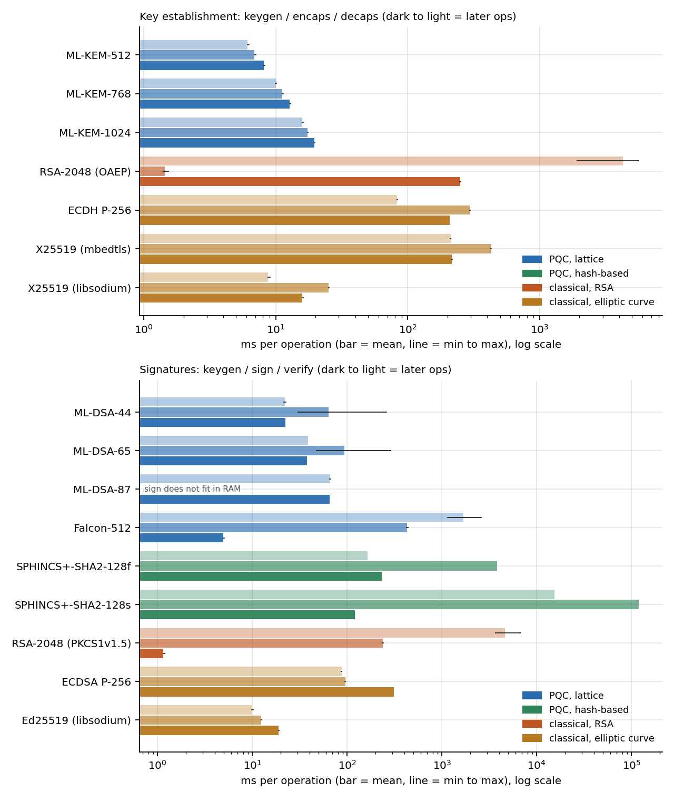
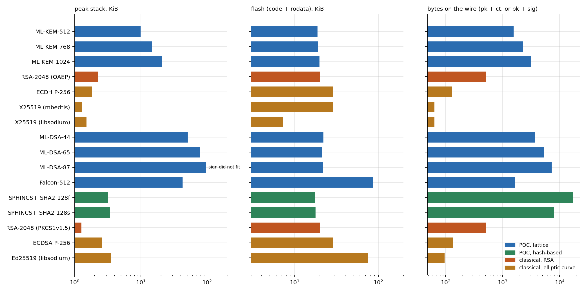

# PQC on an ESP32: latency, memory and size next to classical crypto

This repo is a fork of [PQClean](https://github.com/PQClean/PQClean) with a benchmark added on top. I wanted to know what ML-KEM, ML-DSA, Falcon and SPHINCS+ actually cost on a small microcontroller, compared with the classical algorithms a device like this runs today (RSA-2048, ECDH P-256, X25519, ECDSA P-256, Ed25519). Everything below was measured on one ESP32-D0WD-V3 (Xtensa LX6, 240 MHz, no PSRAM). The upstream PQClean code is untouched. My work is in `firmware/`, `host/`, `analysis/` and `results/`, and the original README is now `PQCLEAN_README.md`.

PQClean is retired and archived (its README has the notice and points to mlkem-native, mldsa-native, slhdsa-c and liboqs for maintained code). I used it anyway because the `clean` C implementations are plain portable C with no assembly, which is what I wanted for a first, honest baseline on Xtensa. Anything I say about speed is about this C code compiled with gcc 8.4 at -O3. It says little about what a tuned ESP32 implementation could do.

## Summary

Measured on one ESP32 (240 MHz, no PSRAM), using the plain-C PQClean implementations:

- A full ML-KEM-768 key exchange (keygen, encaps, decaps) takes 34 ms. That is faster than mbedtls ECDH P-256 (587 ms) and libsodium X25519 (50 ms). The cost is size: 1088-byte ciphertexts and 1184-byte public keys against 32 to 65 bytes for the curves.
- ML-DSA is fast enough (ML-DSA-44 signs in 64 ms on average) but needs a lot of stack: 51 KiB for ML-DSA-44 and 78 KiB for ML-DSA-65. ML-DSA-87 signing did not fit on this board.
- Falcon-512 verifies in 5 ms but takes 1.7 s to generate a key. SPHINCS+ barely needs RAM but signs in 3.8 s (128f) or about 2 minutes (128s).
- "PQC versus classical" depends on which classical library you compare against. Libsodium's X25519 and Ed25519 are 8 to 25 times faster than the mbedtls versions on this chip.
- Energy is not measured, because the board has no current sensor.

## Contents

[Summary](#summary) · [Headline numbers](#headline-numbers) · [What did not fit](#what-did-not-fit) · [How I measured](#how-i-measured) · [Which classical code](#which-classical-code) · [Not measured: energy](#not-measured-energy) · [Limits](#limits-of-these-numbers) · [Related work](#related-work) · [Reproduce](#reproduce) · [Credits](#credits) · [Citation](#citation)

## Headline numbers

Mean over the timed iterations, in ms (the plus/minus is the standard deviation, so it is mostly rejection-sampling noise for ML-DSA, Falcon and RSA keygen). Stack is the peak I measured by painting the stack, over the three operations. Sizes are bytes. The full tables, with n, min, max, heap and code size, are in `results/summary.md` and `results/summary.csv`.

| Algorithm | keygen | encaps | decaps | stack KiB | pk | ct | sk |
|---|---|---|---|---|---|---|---|
| ML-KEM-512 | 6.13 | 6.87 | 8.11 | 9.9 | 800 | 768 | 1632 |
| ML-KEM-768 | 9.99 | 11.2 | 12.8 | 14.7 | 1184 | 1088 | 2400 |
| ML-KEM-1024 | 15.9 | 17.4 | 19.5 | 20.7 | 1568 | 1568 | 3168 |
| RSA-2048 (OAEP) | 4257 &plusmn; 1409 | 1.44 | 250 | 2.3 | 259 | 256 | 640 |
| ECDH P-256 (mbedtls) | 83.3 | 295 | 208 | 1.8 | 65 | 65 | 32 |
| X25519 (mbedtls) | 211 | 428 | 216 | 1.3 | 32 | 32 | 32 |
| X25519 (libsodium) | 8.77 | 25.2 | 15.9 | 1.5 | 32 | 32 | 32 |

| Algorithm | keygen | sign | verify | stack KiB | pk | sig (max) | sk |
|---|---|---|---|---|---|---|---|
| ML-DSA-44 | 22.1 | 63.7 &plusmn; 42.2 | 22.2 | 51.2 | 1312 | 2420 | 2560 |
| ML-DSA-65 | 38.7 | 93.3 &plusmn; 51.8 | 37.6 | 78.2 | 1952 | 3309 | 4032 |
| ML-DSA-87 | 66.0 | does not fit | 65.2 (see below) | 96.0 | 2592 | 4627 | 4896 |
| Falcon-512 | 1675 &plusmn; 461 | 431 | 4.96 | 42.7 | 897 | 752 | 1281 |
| SPHINCS+-SHA2-128f | 163 | 3824 | 231 | 3.2 | 32 | 17088 | 64 |
| SPHINCS+-SHA2-128s | 15474 | 119594 | 121 | 3.5 | 32 | 7856 | 64 |
| RSA-2048 (PKCS#1 v1.5) | 4630 &plusmn; 1260 | 237 | 1.15 | 1.3 | 259 | 256 | 640 |
| ECDSA P-256 (mbedtls) | 87.3 | 95.7 | 310 | 2.6 | 65 | 72 | 32 |
| Ed25519 (libsodium) | 9.88 | 12.4 | 18.8 | 3.5 | 32 | 64 | 64 |




What I read from it, for this C code on this chip:

- ML-KEM is cheap in time. A full ML-KEM-768 exchange (keygen + encaps + decaps) is 34 ms, against 50 ms for libsodium X25519, 587 ms for mbedtls ECDH P-256 and several seconds for RSA-2048 once keygen is counted. What it costs instead is bytes: a 1088-byte ciphertext and 1184-byte public key against 32 or 65 bytes for the curves.
- The mbedtls elliptic-curve code is slow here (P-256 scalar multiplications of 80 to 300 ms), and libsodium's ref10 X25519 and Ed25519 are roughly 8 to 25 times faster. So "PQC versus ECC" depends a lot on which ECC library you pick. I only measured the two that ship with the framework.
- ML-DSA is not slow, but it needs a lot of stack because PQClean keeps the whole expanded matrix on the stack. ML-DSA-65 signing peaked at 78 KiB and ML-DSA-87 signing did not fit (see below). Falcon-512 verifies in 5 ms, which is the best verify of anything here except RSA, but keygen takes 1.7 s and signing 431 ms.
- SPHINCS+ fits easily in RAM (3 KiB of stack) but signing takes 3.8 s (128f) or 2 minutes (128s), and 128f signatures are 17 KB.

## What did not fit

ML-DSA-87 signing. The board resets (reset reason: exception panic) when I give the worker task a 106,484-byte stack, which is almost all of the largest free block of internal RAM. Key generation fits and peaks at 96.0 KiB, so signing needs more than I have. I did not estimate how much more. To still get a verify number, `host/gen_vector.c` makes a key and a signature for ML-DSA-87 on the Mac with the same PQClean source, the host sends them to the board, and the board times and checks `verify`. That row is marked as using an off-board signature in `results/raw/memory.csv`, and the check was 10/10 on a valid signature and 10/10 rejects of a flipped signature byte and a flipped message byte. It also shows the board and the Mac agree on the format.

I left Falcon-1024, the other SPHINCS+ parameter sets, the SHAKE variants and ML-DSA with a context string out; that was a choice about scope, not a failure.

## How I measured

Time: `esp_timer_get_time()` around each call, in a FreeRTOS task pinned to core 1. Each operation runs for a 10 s budget with at least 10 iterations (at most 300), after two warm-up calls. Slow ones use fewer (RSA keygen 5, SPHINCS+-128s 3). The raw per-iteration durations and start times are in `results/raw/latency.csv`.

Stack: before the probe runs I fill the task's stack with a pattern, run the operation twice, and look for the lowest word that changed. This is the high-water mark below the call frame of the benchmark function, so it includes everything the library uses and nothing of mine except a few hundred bytes. The task has a stack of 106,484 bytes taken from the biggest block of internal RAM.

Heap: I wrap `malloc`, `calloc`, `realloc`, `free` and the `heap_caps_*` calls at link time and count live bytes allocated by the worker task, taking the peak over the same probe runs. PQClean is not allocation-free: its incremental SHAKE and SHA-2 state is malloc'd, which is the 200 and 80 bytes in the table. For ECDH and ECDSA the number probably includes the base-point table mbedtls builds the first time a group is used (I did not isolate it). Block sizes are as reported by the heap, not what was requested.

Flash: parsed from the linker map (`analysis/code_size.py`). The PQClean objects are exactly separable. For mbedtls and libsodium I picked the object files each algorithm needs (the list is in `results/code_size.csv`), and `bignum` is counted in both the RSA and the elliptic-curve rows. The flash column in `results/summary.md` for PQC includes the shared SHAKE or SHA-2 code. These are sizes of what the linker kept in my image, not of a minimal firmware per algorithm.

Correctness, on the board, for every algorithm (`results/raw/checks.csv`): KEMs are run 10 times with fresh keys and the two shared secrets are compared, then one byte of the ciphertext is flipped and decapsulation must either fail or give a different secret (ML-KEM does the latter). Signatures: sign, verify, then flip one signature byte and, separately, one message byte, and both must be rejected. RSA and SPHINCS+-128s ran 3 and 2 trials because each takes minutes. All passed.

Randomness: `esp_fill_random` (the ESP32 hardware RNG register) for everything, including PQClean's `randombytes` (`firmware/src/rng.cpp`) and the RNG callback handed to mbedtls. I did not enable the extra entropy source, so with the radio off this is not a certified entropy source. For timing that does not matter. The firmware also has a `SEED` command that switches to a seeded xorshift32 if someone wants a repeatable run; the results here do not use it. The only exception is libsodium's Ed25519 and X25519, whose keys I derive from the same RNG so that all randomness comes from one place.

## Which classical code

mbedtls 2.28.7 from the Arduino-ESP32 framework (PlatformIO platform espressif32 7.1.3, ESP-IDF v4.4.7, gcc 8.4.0): RSA-2048 with e = 65537 (OAEP with SHA-256 for the KEM-like row, PKCS#1 v1.5 with SHA-256 for signatures, private operation with CRT), ECDH P-256, X25519, and ECDSA P-256 with SHA-256 (the config uses deterministic ECDSA). The framework build enables the ESP32 hardware accelerator for big-number operations (`CONFIG_MBEDTLS_HARDWARE_MPI`) and SHA, so RSA exponentiation and large multiplications may go through it; I did not separate that out.

mbedtls has no Ed25519, so Ed25519 comes from libsodium 1.0.12 (also shipped with the framework, portable ref10 code). I added libsodium X25519 as a second X25519 row because the gap to mbedtls is so large.

For the key-establishment rows, ECDH "encaps" means generating an ephemeral key and deriving the secret, and "decaps" is the derive alone, so keygen + encaps + decaps is one complete exchange from both sides. RSA "encaps/decaps" is RSAES-OAEP of a random 32-byte secret. Signature timings for RSA and ECDSA include hashing the 64-byte message with SHA-256. The group and base-point table stay loaded across iterations for ECDH and ECDSA, as they would in a client that keeps its context, and the warm-up calls build them before timing.

## Not measured: energy

Energy is not in this repo. My board has no current sensor, so I have no power or energy numbers, and I did not estimate any from datasheets. The harness is set up so it can be added: every timed call has a start time and duration in `results/raw/latency.csv`, and if the firmware is built with `-DTRIGGER_PIN=<gpio>` it raises that pin for exactly the duration of each timed call (see `window_begin` in `firmware/src/main.cpp`), so a logger on a shunt or an INA219 can be aligned with the windows. Energy per operation would then be the integral of power over each window, minus an idle baseline. I have not tested that path.

## Limits of these numbers

One board, one run of the full sweep, one compiler and optimisation level (-O3 for my files and PQClean; the precompiled mbedtls and libsodium are whatever the framework was built with). The spread I report is within a run, not between boards or temperatures. ML-KEM's spread is tiny because the code is constant-time and there is almost nothing else running; the RTOS tick and the serial driver on the other core are still there. Latency is not a protocol cost: nothing here includes serialising keys, a transport, or certificates. PQClean's `clean` code is not optimised for Xtensa, so the PQC numbers are an upper bound on what is achievable, not an estimate of it. The stack figure is specific to this code and compiler, and the worker task stack of 104 KiB is the ceiling for what I could test.

## Related work

PQC on the ESP32 has been measured before, so this is not a first. Espressif has published an [esp-pqc component](https://developer.espressif.com/blog/2026/10/esp32-post-quantum-cryptography/) with hybrid TLS and its own benchmarks, there is a [multicore ML-KEM implementation for the ESP32](https://sol.sbc.org.br/index.php/sbseg/article/view/36650), and [pqm4](https://github.com/mupq/pqm4) is the standard benchmark suite for the Cortex-M4. I did not read all of these closely, and I did not compare my numbers against theirs. What this repo adds is a small, reproducible measurement of one plain-C code base on one board, with stack, heap, flash and wire sizes next to the classical algorithms from the same toolchain, and the code to rerun it.

## Reproduce

You need PlatformIO and a board on a Raspberry Pi (or any machine; set `PI=user@host` for the machine the board is plugged into; `sync_build.sh` and `run_bench.sh` use it, and `SSH_OPTS` adds ssh options), `pyserial` on that machine, and `pandas` and `matplotlib` locally for the tables.

```
./sync_build.sh                 # copy sources to the Pi and build there (no board access)
./run_bench.sh                  # flash and run under the board lock, copy results/raw back (about 45 minutes)
./run_bench.sh --quick --out /tmp/q   # a few iterations of everything, to check the setup
python3 analysis/make_table.py  # rebuilds summary.csv, summary.md, code_size.csv and both figures from results/raw
./host/gen_vector.sh            # only to regenerate the ML-DSA-87 verify vector
```

The serial protocol is in the header comment of `firmware/src/main.cpp`; `host/board.py` and `host/run_bench.py` are the other side of it.

## Credits

The PQC code is PQClean (Kannwischer, Schwabe, Stebila, Wiggers), which collects the reference implementations of ML-KEM (Kyber), ML-DSA (Dilithium), Falcon and SPHINCS+ from their authors; see `PQCLEAN_README.md` and the licences in each scheme's directory. The classical code is mbedtls (Arm) and libsodium, both through the Espressif Arduino-ESP32 / ESP-IDF packages. None of that code is modified here.

## Licence

The code I added is MIT licensed (see `LICENSE`); the PQClean code keeps its own licences.

## Citation

If you use the numbers or the harness:

```
@misc{esp32_pqc_bench,
  author = {ankushachwani},
  title  = {PQC on an ESP32: latency, memory and size next to classical crypto},
  year   = {2026},
  howpublished = {\url{https://github.com/ankushachwani/esp32-pqc-bench}}
}
```
